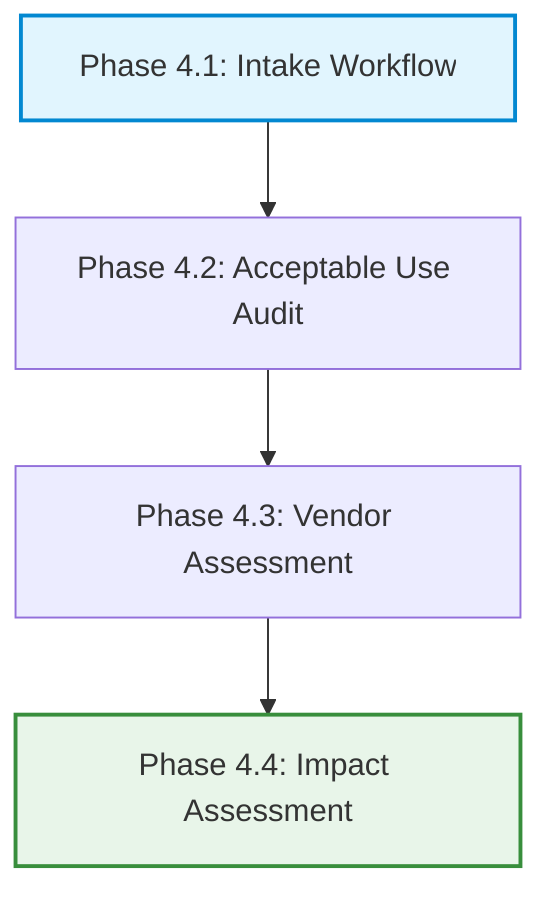

# Enterprise AI Governance & Risk Management Portfolio

Welcome to my enterprise AI Governance portfolio. This repository serves as an active, production-grade reference framework designed to help organizations build robust, audit-ready **AI Management Systems (AIMS)**. 

My work bridges corporate strategy, data ethics, and technical risk control, drawing from my practical experience running enterprise delivery cycles and training in **ISO/IEC 42001 (Lead Implementer)** and the **IAPP AIGP**.

---

## 🗺️ Repository Index & Taxonomy

* **[1-global-foundations](./1-global-foundations/)**: Cross-framework mapping matrices and technical security standards for Large Language Models and retrieval pipelines (RAG).
* **[2-regional-regulations](./2-regional-regulations/)**: Localized compliance playbooks and statutory implementation guides for major international markets.
* **[3-ai-governance-annual-paper](./3-ai-governance-annual-paper/)**: Forward-looking research tracking shifts in global regulations and emerging corporate AI risks.
* **[4-delivery-playbook](./4-delivery-playbook/)**: A phased, end-to-end operational deployment pipeline guiding AI projects from initial intake through vendor assessment to risk mitigation.

---

## 🛠️ The Phase-Based AI Delivery Pipeline

This lifecycle tracks how a corporate AI project moves from initial ideation to secure production deployment, clearing strict risk gates at each checkpoint:

---

## 🎯 Professional Core Competencies
* **AI Management System Design:** Implementing organizational controls aligned with ISO/IEC 42001.
* **Algorithmic Bias Auditing:** Running pre-launch statistical fairness checks using demographic parity metrics.
* **Technical Security Vetting:** Auditing applications using the OWASP GenAI and Agentic Top 10 vulnerabilities.
* **Vendor Due Diligence:** Vetting external third-party models for Zero Data Retention (ZDR) and privacy compliance.
* **Cross-Functional Enablement:** Translating complex laws into step-by-step developer scripts and workflows.

---

## 👤 About the Author
Senior technology delivery and governance leader with over 20 years of enterprise experience managing complex software architectures, vendor delivery lifecycles, and modern AI compliance pipelines within highly secure, globally regulated banking environments.

* **LinkedIn:** [://linkedin.com](https://www.://linkedin.com)
* **Email:** sharma.rajat.work@gmail.com

---

## ⚖️ Legal Disclaimer & Terms of Use
*The content provided across this entire repository and its sub-directories is intended solely for educational, informational, and professional portfolio demonstration purposes. It does not constitute formal legal advice, regulatory counseling, or professional compliance auditing. While every effort is made to maintain factual accuracy relative to shifting global regulatory benchmarks, users must consult qualified legal counsel or certified data protection authorities before implementing these frameworks in a commercial production environment. The author accepts no liability for operational, financial, or legal actions resulting from the independent application of this material.*
