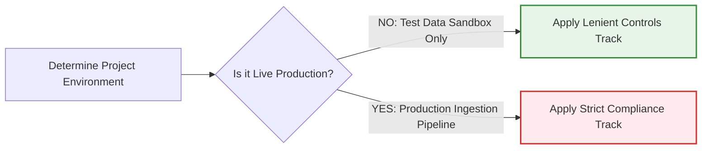

# 4.2.1 - Cross-Functional POC Review Sign-off Checklist

> **🗂️ Document Control Reference**
> * **Framework Index:** TK-SEC-4.2.1 (POC Review Stage)
> * **Current Version:** v1.2
> * **Last Operational Review:** October 2026
> * *⚙️ Operational Customization Note: This template serves as an adaptive baseline overlay and can be customized or expanded to align with your organization's specific technical, legal, and operational risk appetites.*
> * *Note: Subject to the master legal disclaimer located in the repository root [README.md](../../README.md).*

---

## 🏛️ Module 1: The AI-Specific Governance Overlay Strategy

### 1. Traditional Baseline Exclusion Principle
This framework does **not** replace or duplicate your organization’s existing, traditional IT risk processes. All standard corporate compliance requirements—including **non-AI cybersecurity baselines** (service accounts validation, database access management, general threat-modeling, server hardening) and **non-AI data privacy rules** (access logging, standard encryption-at-rest)—must be cleared independently via your standard corporate security desks.

This checklist serves strictly as an **AI-Specific Governance Overlay**. It defines the mandatory extra safety checks required *only* because an application utilizes artificial intelligence, large language models, or autonomous agent loops.

### ⚖️ 2. Environmental Adaptive Rigor Matrix
The depth and strictness of these AI-specific controls dynamically scale based on the project's data environment setup:

---

## 🛡️ Module 2: The Adaptive Cross-Functional Checklist

*Reviewing officers must check the appropriate track box (**Lenient vs. Strict**) based on the environmental scoping rules defined in Module 1 before signing off.*

### 💻 1. Cybersecurity Review (InfoSec Overlay)
*Complements standard corporate threat modeling by enforcing technical defenses aligned with the **[OWASP AI Security Manual](../../1-global-foundations/1.3.1-owasp-ai-security-manual.md)** and **[OWASP API Security Manual](../../1-global-foundations/1.3.2-owasp-api-security-manual.md)**.*

#### 🟢 TRACK A: Lenient Controls (Test Environments & Synthetic Data Only)
- [ ] **Baseline Prompt Isolation (`LLM01`):** Verify that hardcoded system prompt frameworks separate standard developer instructions from test user queries to prevent basic session jailbreaks.
- [ ] **Sandbox Access Segmentation:** Confirm the test instance is network-isolated and cannot execute outbound calls to live external web horizons.

#### 🔴 TRACK B: Strict Controls (Production Systems & Ingestion Pipelines Active)
- [ ] **Advanced Prompt Injection Defense (`LLM01` / `AGE01`):** Implement active semantic shield models (e.g., LlamaGuard) to evaluate and block injection vectors in real-time.
- [ ] **Insecure Output Sanitization (`LLM02`):** Configure output token filtering layers to sanitize raw text generations before they render on client screens.
- [ ] **API Token & Key Rotation (`API2`):** Verify connection keys connecting internal systems to external model endpoints are housed in secure vaults and rotated automatically.

---

### 🔒 2. Data Governance Review (Privacy Office Overlay)
*Complements standard encryption rules by enforcing data controls aligned with **[ISO/IEC 42001 Annex A.8](../../1-global-foundations/1.2-iso-42001-translation-manual.md)**, **India DPDP Act 2023**, and **EU GDPR**.*

#### 🟢 TRACK A: Lenient Controls (Test Environments & Synthetic Data Only)
- [ ] **Synthetic Data Attestation:** Verify that the sandbox utilizes 100% randomized, mock, or open-source reference data libraries. The ingestion of real consumer records is strictly prohibited.

#### 🔴 TRACK B: Strict Controls (Production Systems & Ingestion Pipelines Active)
- [ ] **Automated PII Scrubbing Validation:** Confirm that **PII Tokenization Filters** are written directly into ingestion scripts to strip customer names and identifiers before data lands in vector memories [2.4].
- [ ] **Data Training Opt-Out Enforcement:** Verify that vendor API connections carry explicit parameters blocking the supplier from utilizing your text inputs for base model optimization [2.3, 2.5].
- [ ] **Data Principal Erasure Mapping:** Build and test automated deletion scripts to purge embeddings from vector spaces upon customer request [2.4].

---

### 📊 3. Model Quality & Stability Review (Validation Overlay)
*Complements standard software QA by enforcing reliability metrics aligned with the **[NIST AI RMF 1.0 Manual](../../1-global-foundations/1.4-nist-rmf-translation-manual.md)**.*

#### 🟢 TRACK A: Lenient Controls (Test Environments & Synthetic Data Only)
- [ ] **Static Accuracy Benchmarking:** Run a pre-release evaluation pass using static test datasets to record a baseline model precision score.

#### 🔴 TRACK B: Strict Controls (Production Systems & Ingestion Pipelines Active)
- [ ] **Live Hallucination Shielding (Groundedness Monitoring):** Deploy real-time evaluation frameworks (e.g., TruLens) to continuously calculate and log text grounding metrics.
- [ ] **Vector Database Performance Tracking:** Set up daily automated audit runs to track Context Precision and Context Recall within the database chunking engine.
- [ ] **Continuous Accuracy Verification:** Configure live telemetry monitoring to track concept drift and send alerts if precision scores degrade over time.

---

### ⚖️ 4. Legal & Procurement Review (Risk Counsel Overlay)
*Complements standard vendor contract reviews by enforcing compliance aligned with **[ISO/IEC 42001 Annex A.10](../../1-global-foundations/1.2-iso-42001-translation-manual.md)**.*

#### 🟢 TRACK A: Lenient Controls (Test Environments & Synthetic Data Only)
- [ ] **Permissible License Check:** Verify that model weights, wrappers, and developer software libraries carry permissible corporate open-source deployment licenses.

#### 🔴 TRACK B: Strict Controls (Production Systems & Ingestion Pipelines Active)
- [ ] **Zero-Data-Retention (ZDR) Contract Review:** Verify that the commercial agreement contains legally binding ZDR clauses protecting company data from external ingestion [2.3, 2.5].
- [ ] **Algorithmic Liability Indemnification:** Ensure supplier terms explicitly include liability protection against third-party copyright or output model infringement claims.
