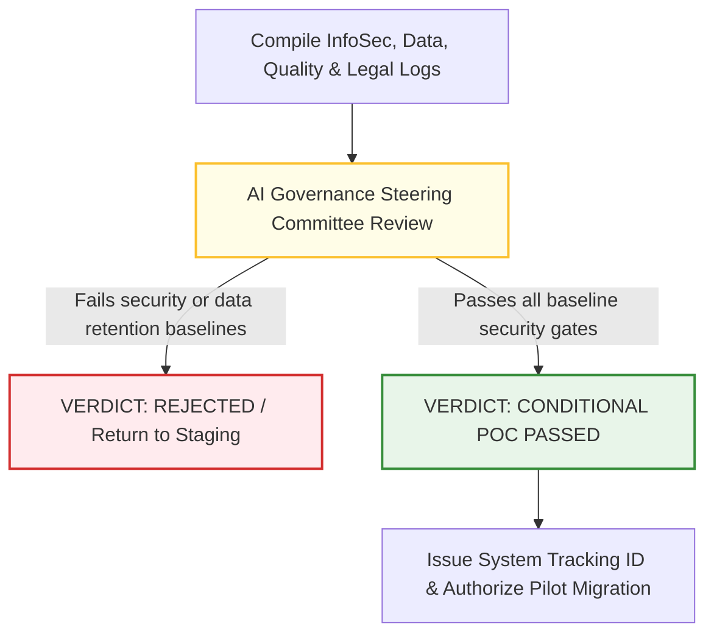

# 4.2 - Gate 1: Proof of Concept (POC) Compliance Manual

> **🗂️ Document Control Reference**
> * **Framework Index:** TK-SEC-4.2.0 (POC Gate Core)
> * **Current Version:** v1.2
> * **Last Operational Review:** October 2026
> * *Note: Subject to the master legal disclaimer located in the repository root [README.md](../../README.md).*

---

## 🏛️ Module 1: Objective & Scope
Once an AI use case clears sandbox testing and moves toward prototype construction with actual corporate infrastructure, it triggers **Gate 1 (POC)**. The objective of this gate is to conduct code-level and data-lineage safety audits inside a secure, non-live environment. Because this occurs inside a sandboxed prototype stage, zero live production systems or actual consumer assets are exposed to risk.

---

## 👥 Module 2: Cross-Functional Vetting Teams & Ownership

Four highly specialized risk groups must independently audit the prototype during this gate and sign off on its compliance logs:

### 1. The Cybersecurity Review Team (InfoSec Architects)
* **Operational Scope:** Audits the application code, integration pipelines, and API hooks [2.1].
* **AI-Specific Focus:** Evaluates the prototype against **OWASP GenAI and Agentic Top 10 vulnerabilities**. They stress-test input parameters to check for prompt injection vulnerabilities (`LLM01`) and audit output configurations to ensure raw model responses are properly sanitized before rendering (`LLM02`) [2.1].

### 2. The Data Review Team (Data Governance Office)
* **Operational Scope:** Audits the data ingestion and storage supply chain.
* **AI-Specific Focus:** Verifies data provenance and tracks compliance with regional laws like India's DPDP Act and GDPR [2.1, 2.4]. They ensure that training or fine-tuning files do not ingest un-masked consumer data, and mandate that automated **PII Scrubbing** loops are written directly into the ingestion layers [2.4].

### 3. The Quality Review Team (Model Validation Unit)
* **Operational Scope:** Audits model logic, behavioral stability, and grounding pipelines.
* **AI-Specific Focus:** Evaluates the prototype's baseline performance. They benchmark token output reliability, establish fluency parameters, and test the system's chunking engine to calculate initial context precision and context recall values.

### 4. The Legal & Procurement Team (Technology Risk Counsel)
* **Operational Scope:** Reviews third-party software contracts and model hosting licenses.
* **AI-Specific Focus:** Evaluates external suppliers using strict vendor due diligence filters [2.1]. They ensure the vendor contract explicitly guarantees **Zero Data Retention (ZDR)** via API connections, legally prohibiting the supplier from using your corporate inputs to train public base models [2.3, 2.5].

---

## ⚙️ Module 3: AI Steering Committee Approval & Verdict Flow

Once all four vetting units complete their technical audits, the compiled logs, risk scores, and vendor questionnaires are submitted to the centralized **Enterprise AI Governance Steering Committee** for formal evaluation:

* **The Approval Threshold:** The committee reviews the prototype's risk posture. If the application utilizes an unvetted vendor API or processes unmasked PII without a valid legal mechanism, it is handed a **Critical Block** and sent back to development [2.4, 2.5]. If cleared, the committee issues a unique **System Tracking ID**, allowing the engineering team to migrate code into the pre-production Pilot (UAT) environment.

---

## 📋 Module 4: Active Gate Templates & Checklists
*To clear Gate 1, compliance officers and engineering teams utilize these downloadable tools:*
* 👉 **[4.2.1 - Generative AI Acceptable Use Policy](../4.2-generative-ai-acceptable-use-policy.md)**: Workforce boundaries governing employee and developer interactions with LLM code blocks [2.1].
* 👉 **[4.2.2 - Third-Party Vendor Vetting Questionnaire](../4.3-third-party-vendor-vetting-questionnaire.md)**: The technical risk audit form sent to external AI suppliers to verify data siloing and infrastructure controls [2.1].
