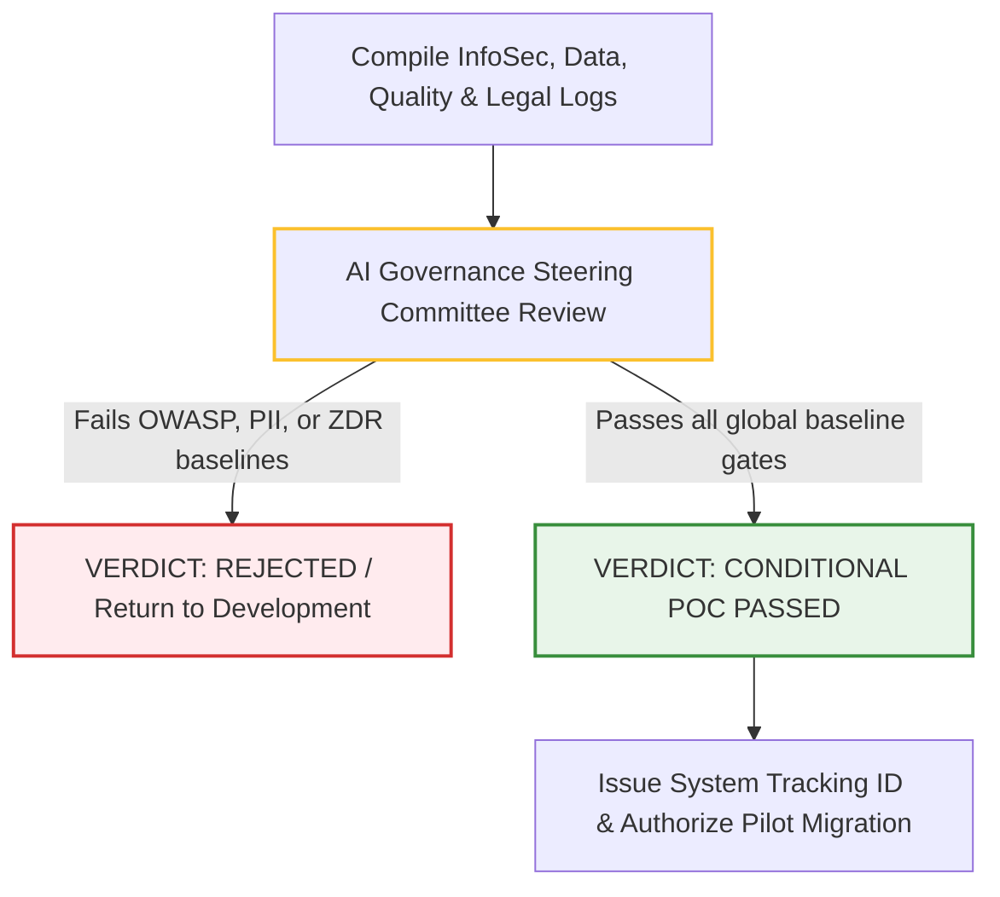

# 4.2 - Gate 1: Proof of Concept (POC) Compliance Manual

> **🗂️ Document Control Reference**
> * **Framework Index:** TK-SEC-4.2.0 (POC Gate Core)
> * **Current Version:** v1.2
> * **Last Operational Review:** October 2026
> * *⚙️ Operational Customization Note: All processes, checklists, workflows, and templates provided within this manual are designed as modular baselines and can be fully customized, expanded, or modified to align with your specific organizational needs.*
> * *Note: Subject to the master legal disclaimer located in the repository root [README.md](../../README.md).*

---

## 🏛️ Module 1: Objective & Scope (ISO/IEC 42001 Alignment)

Once a sandbox-tested AI use case moves toward prototype construction with actual corporate infrastructure, it triggers **Gate 1 (POC)**. The core objective of this gate is to conduct deep technical code audits and data-lineage safety reviews within a secure, non-production staging environment. 

### ⚙️ Global Standard Grounding:
This stage directly operationalizes the frameworks outlined in **[Document 1.2 - ISO/IEC 42001 Translation Manual](../../1-global-foundations/1.2-iso-42001-translation-manual.md)** under **Clause 6.1.2 (AI Risk Assessment Process)**, which mandates that organizations systematically identify, analyze, and evaluate AI-specific risks [2.1]. Because this occurs inside an isolated prototype environment, zero live production data assets or consumer profiles are exposed to operational risk.

---

## 👥 Module 2: Cross-Functional Vetting Teams & Global Standards Mapping

Four highly specialized risk groups must independently audit the prototype during this gate. To ensure global alignment, every review layer maps directly to interactive, deep-dive reference manuals located inside Sections 1 and 2 of this repository:

### 1. The Cybersecurity Review Team (InfoSec Architects)
* **Operational Scope:** Audits application source code, API integration parameters, and prompt configurations [2.1].
* **Global Standard Alignment Links:** 
  * 📑 **[Document 1.3.1 - OWASP AI Security Manual](../../1-global-foundations/1.3.1-owasp-ai-security-manual.md)** (For Core LLM prompt vulnerabilities)
  * 📑 **[Document 1.3.2 - OWASP API Security Manual](../../1-global-foundations/1.3.2-owasp-api-security-manual.md)** (For integration bridge boundaries)
* **AI-Specific Focus:** Evaluates the prototype against direct and indirect prompt injection vulnerabilities (`LLM01`/`AGE01`), checks for insecure output handling (`LLM02`), and audits system components to prevent unauthorized remote execution hacks.

### 2. The Data Review Team (Data Governance Office)
* **Operational Scope:** Audits the dataset ingestion supply chain, token storage, and RAG retrieval pipelines [2.1].
* **Global Standard Alignment Links:** 
  * 📑 **[Document 2.4 - India DPDP AI Governance Manual](../../2-regional-regulations/2.4-india-dpdp-ai-governance.md)** (For consent limits and principal erasure) [2.4]
  * 📑 **[Document 2.1 - EU AI Act Compliance Handbook](../../2-regional-regulations/2.1-eu-ai-act-compliance-handbook.md)** (For GDPR-linked data provenance limits) [2.1]
* **AI-Specific Focus:** Establishes strict data provenance. They enforce automated **PII Scrubbing** and data masking inside ingestion code lines, ensuring no raw personal identifiers are written into vector databases or cached in model history windows [2.4].

### 3. The Quality Review Team (Model Validation Unit)
* **Operational Scope:** Audits model behavioral stability, grounding layers, and token output consistency.
* **Global Standard Alignment Link:** 
  * 📑 **[Document 1.4 - NIST AI RMF Manual](../../1-global-foundations/1.4-nist-rmf-translation-manual.md)** (Focusing on the Measure & Manage functions)
* **AI-Specific Focus:** Benchmarks the prototype's reliability. They test the RAG chunking engine to calculate initial context precision and context recall values, setting up a mathematical defense against model hallucinations.

### 4. The Legal & Procurement Team (Technology Risk Counsel)
* **Operational Scope:** Reviews third-party software licenses, commercial SaaS terms, and foundational model endpoints.
* **Global Standard Alignment Link:** 
  * 📑 **[Document 1.2 - ISO/IEC 42001 Translation Manual](../../1-global-foundations/1.2-iso-42001-translation-manual.md)** (Focusing on Annex A.10 - Relationships with Stakeholders) [2.1]
* **AI-Specific Focus:** Executes strict vendor due diligence checks using **Zero Data Retention (ZDR)** parameters. They verify that the vendor contract legally prohibits the supplier from using your corporate inputs to train public base models [2.3, 2.5].

---

## ⚙️ Module 3: AI Steering Committee Approval & Verdict Flow

Once all four vetting units complete their independent technical audits, the compiled logs, risk scores, and vendor questionnaires are submitted to the centralized **Enterprise AI Governance Steering Committee** for formal evaluation:

* **The Approval Threshold:** The committee evaluates the prototype's residual risk posture. If the system uses non-ZDR vendor hooks or violates ISO 42001 data governance rules, it faces an immediate **Critical Block** [2.1, 2.3]. If cleared, it receives a **System Tracking ID**, authorizing the delivery team to migrate code into the Pilot (UAT) environment.

---

## 📋 Module 4: Active Gate Templates & Checklists
*To execute the specific lifecycle gates defined across this process, customize, download, and deploy these operational tools:*

* 📄 **[4.2.1 - Cross-Functional POC Review Checklist](./4.2.1-cross-functional-poc-review-checklist.md)**: Exhaustive technical checklists for Cybersecurity, Data, Quality, and Legal review teams aligned with OWASP, NIST, and ISO 42001 [2.1].
* 📋 **[4.2.2 - AI Steering Committee Approval Form](./4.2.2-ai-steering-committee-approval-form.md)**: The official corporate sign-off form and verdict sheet used by the AI Governance Board to authorize pilot migration.
* 🛡️ **[4.2.3 - Generative AI Acceptable Use Policy](../4.2-generative-ai-acceptable-use-policy.md)**: Workforce behavioral boundaries governing employee and developer interactions with LLM code blocks [2.1].
* 🔍 **[4.2.4 - Third-Party Vendor Vetting Questionnaire](../4.3-third-party-vendor-vetting-questionnaire.md)**: The technical risk audit form sent to external AI suppliers to verify data siloing and infrastructure controls [2.1].

