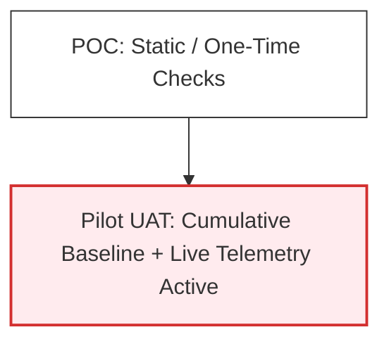

# 4.3 - Gate 2: Pilot Deployment (UAT) Compliance Manual

> **🗂️ Document Control Reference**
> * **Framework Index:** TK-SEC-4.3.0 (Pilot Gate Core)
> * **Current Version:** v1.2
> * **Last Operational Review:** October 2026
> * *⚙️ Operational Customization Note: All processes, checklists, workflows, and templates provided within this manual are designed as modular baselines and can be fully customized, expanded, or modified to align with your specific organizational needs.*
> * *Note: Subject to the master legal disclaimer located in the repository root [README.md](../../README.md).*

---

## 🏛️ Module 1: Objective & The Cumulative Rigor Principle

When a project migrates into a **User Acceptance Testing (UAT)** or localized pilot testing group, it triggers **Gate 2 (Pilot)** [2.1]. 

AI Governance operates on the **Cumulative Rigor Principle**: moving to a new phase does not mean abandoning previous checks. The core governance cycle for Cybersecurity, Data, Quality, and Legal teams runs continuously [2.1]. However, because the system is now exposed to real-world user queries and infrastructure loads, the evaluation criteria become **strict, live, and automated** [2.1].

---

## 👥 Module 2: The Escalated Cross-Functional Review Cycle

Every risk group must re-evaluate the system during the Pilot stage, shifting their focus from static prototype code to live operational performance:

### 💻 1. Cybersecurity Review (Escalated InfoSec Overlay)
* **The POC Baseline:** Static code analysis checking for basic prompt injections (`LLM01`) [2.1].
* **The Escalated Pilot Requirement:** Turning on **Live Technical Telemetry**.
* **Global Standard Alignment:** **[Document 1.3.1 - OWASP AI Security](../../1-global-foundations/1.3.1-owasp-ai-security-manual.md)** & **[Document 1.3.2 - OWASP API Security](../../1-global-foundations/1.3.2-owasp-api-security-manual.md)** [2.1].
* **The Operational Fix:** Developers must implement **[Document 4.5 - Monitoring Log Schema](../4.5-enterprise-ai-monitoring-log-schema.md)** [2.1]. The application must output real-time, text-based logs tagged with explicit alphanumeric markers (e.g., `[AI-SEC-INJ]`) to track active jailbreak attempts under load.

### 🔒 2. Data Governance Review (Escalated Privacy Overlay)
* **The POC Baseline:** Verifying theoretical data maps and checking sandboxed PII masking [2.4].
* **The Escalated Pilot Requirement:** **Live Data Lineage Auditing**.
* **Global Standard Alignment:** **[Document 1.2 - ISO/IEC 42001 Annex A.8](../../1-global-foundations/1.2-iso-42001-translation-manual.md)** & **[Document 2.4 - India DPDP Manual](../../2-regional-regulations/2.4-india-dpdp-ai-governance.md)** [2.1, 2.4].
* **The Operational Fix:** Data teams must run continuous log extractions (`[AI-PRIV-PII]`) to mathematically verify that the **PII Scrubbing** engine successfully tokenizes and sanitizes user personal data before queries touch the vector database cache [2.4].

### 📊 3. Model Quality & Stability Review (Escalated Validation Overlay)
* **The POC Baseline:** Running static, one-time accuracy tests against frozen datasets.
* **The Escalated Pilot Requirement:** **Continuous Real-Time Evaluation**.
* **Global Standard Alignment:** **[Document 1.4 - NIST AI RMF Manual](../../1-global-foundations/1.4-nist-rmf-translation-manual.md)** (Measure & Manage Functions).
* **The Operational Fix:** Compliance teams must implement **[Document 4.6 - Production Monitoring Assessment Matrix](../4.6-ai-production-monitoring-assessment.md)** [2.1]. The UAT environment must run automated, continuous calculations to log quantitative metrics for **Groundedness, Answer Relevance, and Context Precision** to block hallucinations dynamically.

### ⚖️ 4. Legal & Procurement Review (Escalated Risk Counsel Overlay)
* **The POC Baseline:** Auditing open-source software licenses and verifying vendor contract templates [2.1].
* **The Escalated Pilot Requirement:** **Algorithmic Fairness Validation**.
* **Global Standard Alignment:** **[Document 2.1 - EU AI Act High-Risk Gates](../../2-regional-regulations/2.1-eu-ai-act-compliance-handbook.md)** [2.1].
* **The Operational Fix:** Risk teams must deploy **[Document 4.4 - Algorithmic Impact Assessment Template](../4.4-algorithmic-impact-assessment-template.md)** to execute automated audits over the pilot data registry [2.1]. If selection rates across protected demographic cohorts violate the statistical **Four-Fifths Rule threshold ( adverse impact ratio < 0.80)**, an immediate compliance halt is triggered.

---

## ⚙️ Module 3: Escalated Governance Sign-off Hierarchy

Because the Pilot environment exposes the enterprise system to actual user interactions, final clearance requires escalating the approval authority beyond the baseline steering committee:

1. **The Telemetry Attestation:** The AI Governance Lead reviews the live pilot dashboard ledger, verifying that the alphanumeric log-tags are compiling accurately.
2. **The Executive Sign-off:** The compiled metrics, fairness ratios, and security threat logs are submitted to the **AI Governance Steering Committee**. For high-risk applications, final production deployment authorization requires a formal joint signature from the **Global Executive Line-of-Business Head** and the regional **Chief Data Protection Officer** [2.1].
