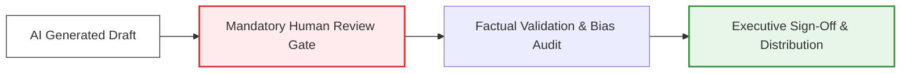

# 4.2 - Enterprise Generative AI Acceptable Use Policy Template

> **🗂️ Document Control Reference**
> * **Framework Index:** TK-SEC-4.2
> * **Current Version:** v1.2
> * **Last Operational Review:** October 2026
> * *Note: Subject to the master legal disclaimer located in the repository root [README.md](../README.md).*

---

## 🏛️ Module 1: Executive Summary & Objective

With the rapid adoption of commercial Large Language Models (LLMs) and autonomous agent workflows, organizations face unprecedented exposure to legal, privacy, and intellectual property liabilities [2.1]. Employees frequently input proprietary software code, trade secrets, or confidential client data into public consumer-grade models without realizing those inputs are harvested to optimize public foundation engines. 

This corporate policy establishes clear, binding boundaries for acceptable use regarding Generative Artificial Intelligence (GenAI) across the entire enterprise workforce to safeguard corporate equity and maintain compliance with global data protection gates [2.1].

---

## 👥 Module 2: Corporate Policy Scope

This policy applies to all full-time employees, part-time staff, external contractors, and third-party vendors operating on behalf of the organization. It governs the interaction with all external text engines, code assistants, image/video generators, and automated analytical platforms.

---

## 🛡️ Module 3: Permitted vs. Prohibited Workflows

### 🟢 Permitted Workflows (Low-Risk Data)
* **Administrative Drafting Assistance:** Utilizing enterprise-approved, zero-data-retention tools to draft emails, summarize public industry articles, or format internal meeting agendas.
* **Creative Brainstorming:** Generating structural outlines for presentations or testing conceptual ideas using purely public domain data.
* **Isolated Code Refactoring:** Deploying corporate-licensed IDE autocomplete plugins on open-source, non-proprietary code structures within secure network boundaries.

### 🔴 Strictly Prohibited Workflows (Severe Liability Risk)
* **Personally Identifiable Information (PII) Exfiltration:** Pasting customer or employee data (names, identity numbers, account values) into unvetted, public consumer tools, constituting a severe breach of frameworks like the EU AI Act and India's DPDP Act [2.1, 2.4].
* **Intellectual Property Exposure:** Uploading core proprietary source code, internal software scripts, pending patent filings, or unreleased financial reports into non-corporate public environments.
* **Unreviewed Automated Decision-Making:** Relying on AI text or scoring outputs to directly execute high-stakes human resources tasks, hiring decisions, performance evaluations, or service rejections without mandatory human review gates [2.1, 2.3].

---

## 📊 Module 4: The Corporate Data Handling Matrix

To ensure compliance with corporate data loss prevention (DLP) frameworks, all personnel must reference this matrix before inputting any dataset or query into an active AI application:

| Corporate Data Classification | Consumer GenAI Tools (Free Public Tier) | Enterprise GenAI Tools (Corporate Account) | Required Operational Actions |
| :--- | :--- | :--- | :--- |
| **Public Data** (Press releases, public reports) | Allowed | Allowed | Standard verification checks. |
| **Internal Only Data** (Meeting summaries, training notes) | **STRICTLY PROHIBITED** | Allowed | Verify that vendor **Zero Data Retention (ZDR)** options are active. |
| **Restricted PII & Financials** (Customer balances, tax IDs) | **STRICTLY PROHIBITED** | **STRICTLY PROHIBITED** | Enforce automated **PII Scrubbing**; requires an AI Governance Board waiver [2.4]. |
| **Source Code & Core IP** (Proprietary software, logic arrays) | **STRICTLY PROHIBITED** | Allowed | Utilize authorized corporate code environments with secure data silos. |

---

## 🤖 Module 5: Human-in-the-Loop (HITL) Validation Workflow

All AI-generated content intended for external distribution, client delivery, or regulatory filing must clear a mandatory human validation gate prior to system release:

### 📋 The Mandatory Verification Checklist:
* **Factual Hallucination Check:** Requestors are individually and professionally liable for verifying the mathematical, technical, and historical accuracy of any output before publishing.
* **Data Provenance & Plagiarism Audit:** Content must be audited to ensure it does not recreate copyrighted data structures or source files.
* **Algorithmic Bias Review:** Outputs must be reviewed to guarantee they deliver inclusive, equitable vocabulary free from discriminatory language patterns.

---

## 🔍 Module 6: Enforcement & Continuous Compliance Audits

Compliance with this policy is continuously monitored using corporate network Data Loss Prevention (DLP) filters and security endpoint monitors. Any unauthorized transmission of internal source files or customer data to unvetted public AI URLs constitutes a material security policy violation. 

Non-compliance will result in immediate system access revocation and formal disciplinary action, up to and including termination of contract or employment.
