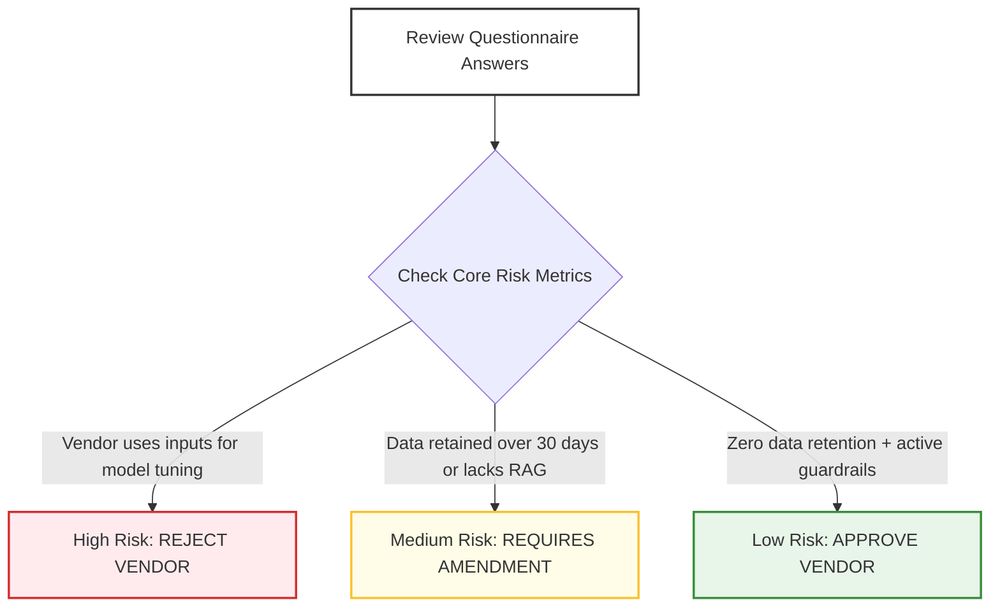

# 4.3 - Third-Party AI Vendor Risk Assessment Questionnaire Template

> **🗂️ Document Control Reference**
> * **Framework Index:** TK-SEC-4.3
> * **Current Version:** v1.2
> * **Last Operational Review:** October 2026
> * *Note: Subject to the master legal disclaimer located in the repository root [README.md](../README.md).*

---

## 🏛️ Module 1: Executive Summary & Objective

Modern enterprises rarely engineer foundational large language models entirely from scratch; instead, they scale operations by connecting internal data pipelines to external third-party software vendors, commercial SaaS platforms, and model API hooks. This creates critical operational dependencies on third-party security postures. 

This due-diligence vetting questionnaire provides a binding, standardized auditing protocol for procurement leads and technology risk officers [2.1]. It ensures external vendor systems are exhaustively assessed for data privacy, model reliability, and cybersecurity robustness prior to enterprise integration, strictly satisfying **ISO/IEC 42001 (Annex A.10 - Relationships with Stakeholders)** and global banking vendor liability mandates [2.3, 2.5].

---

## 📋 Module 2: Vendor Information & Product Profile
* **Vendor Organization Name:** __________________________________________________
* **AI Product / Service Name:** __________________________________________________
* **Core Architecture Type:** *(e.g., Commercial API, Dedicated Tenant SaaS, Fine-Tuned Weights)*
  __________________________________________________________________________________________________
* **Primary Foundation Model Engine:** *(e.g., GPT-4o, Claude 3.5 Sonnet, Custom Fine-Tuned Llama-3)*
  __________________________________________________________________________________________________

---

## 🛡️ Module 3: Core AI Risk Evaluation Questionnaire

*The responding supplier must complete all fields with accompanying technical documentation and architectural blueprints where required.*

### 🔒 Section A: Data Governance, Privacy & Sovereignty
* **A.1 Model Training Opt-Out & Siloing:** Does your organization utilize, log, or cache input prompts, contextual text, or corporate data files submitted via this service to retrain or optimize public foundation models or fine-tune assets for other clients?
  * **Supplier Response:** [ ] Yes  [ ] No
  * **Technical Verification Required:** *If No, explicitly cite the API parameter, cryptographic flag, or enterprise contract clause that guarantees absolute data siloing.*
    __________________________________________________________________________________________________
* **A.2 Data Retention Windows & In-Flight Logging:** Detail the exact timeline that client transaction data, prompts, and output generations are retained on your servers for monitoring or security tracing.
  * **Supplier Response:** [ ] Immediate Deletion (Zero Data Retention)  [ ] Max 30 Days  [ ] Indefinite
  * **Technical Verification Required:** *Document the server scrubbing mechanism executed at the end of the data retention cycle.*
    __________________________________________________________________________________________________
* **A.3 Geographic Data Residency & Sovereignty:** Map the exact physical data centers and jurisdictions where our enterprise data will be transmitted, cached, and processed.
  * **Supplier Response:** [ ] United Arab Emirates (UAE clusters) [2.5]  [ ] European Union (EU regions) [2.1]  [ ] Singapore [2.3]  [ ] United States  [ ] Other: ______________

### ⚖️ Section B: Model Reliability, Safety & Algorithmic Ethics
* **B.1 Algorithmic Bias Mitigation:** What specific statistical methodologies and red-teaming protocols do your engineering teams execute to audit, measure, and mitigate demographic or systemic biases within the model's output layers?
  * **Technical Verification Required:** *Provide your latest independent fairness audit or benchmark metrics summary.*
    __________________________________________________________________________________________________
* **B.2 Hallucination Grounding Architecture:** Does your software application utilize Retrieval-Augmented Generation (RAG), vector matching, or localized grounding frameworks to enforce factual verification and prevent model hallucinations?
  * **Technical Verification Required:** *Detail your architectural approach to token verification and source file attribution.*
    __________________________________________________________________________________________________

### 💻 Section C: Cybersecurity & Technical Vulnerabilities (OWASP AI Alignment)
* **C.1 Prompt Injection and Jailbreak Defenses:** What technical guardrails, semantic filters, or system prompt walls are built into your product's input layer to mitigate **OWASP LLM01 direct and indirect prompt injection attacks**?
  * **Technical Verification Required:** *Detail the input validation software layers currently deployed.*
    __________________________________________________________________________________________________
* **C.2 Data Poisoning & Model Inversion Safeguards:** How do you protect your data supply chain, model weights, and embedding pipelines against **OWASP LLM03 (Training Data Poisoning)** and unauthorized model inversion exploits?
  * **Technical Verification Required:** *Provide your latest SOC 2 Type II or ISO/IEC 42001 certification numbers and independent audit dates.*
    __________________________________________________________________________________________________

---

## 📊 Module 4: Procurement Evaluation Matrix & Triage Workflow

Enterprise risk officers utilize this standardized scoring rubric to determine if a supplier can be safely onboarded based on questionnaire responses:

| Evaluation Domain | Risk Tier / Trigger Criteria | Mandatory Procurement Verdict |
| :--- | :--- | :--- |
| **Data Retention & Tuning** | Vendor utilizes inputs for public model fine-tuning. | 🔴 **Critical Block** (Unacceptable Risk - Immediate Rejection) |
| **Operational Auditing** | Vendor lacks independent third-party **SOC 2 Type II** or **ISO 42001** certification records. | 🟡 **High Risk** (Requires formal executive exception and board-level waiver) |
| **Infrastructure Defenses** | Vendor enforces strict automated input/output filtering and provides dedicated single-tenant **Zero Data Retention (ZDR)** API channels. | 🟢 **Low Risk** (Approved for infrastructure deployment) |
