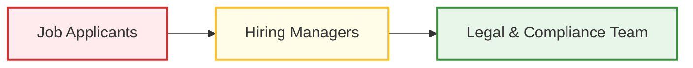

# 4.4 - Algorithmic Impact Assessment (AIA) Template

> **🗂️ Document Control Reference**
> * **Framework Index:** TK-SEC-4.4
> * **Current Version:** v1.2
> * **Last Operational Review:** October 2026
> * *Note: Subject to the master legal disclaimer located in the repository root [README.md](../README.md).*

---

## 🏛️ Module 1: Executive Summary & System Profile

This template serves as a deep-dive auditing framework designed to evaluate and document high-risk automated decision systems before live commercial deployment. It ensures that complex models—such as predictive underwriting, biometric profiling, and machine-learning recruitment tools—actively satisfy the ethical requirements of the **IAPP AIGP** framework and the risk management protocols of **ISO/IEC 42001 (Clause 6.1.2)**.

### 📋 Target System Evaluation Profile
* **System Under Assessment:** TalentScout AI (Automated Employment Screening Engine)
* **Operational Objective:** Automatically ingest, parse, rank, and filter inbound job applicant resumes to generate a top-tier recommendation dashboard for corporate recruiters.
* **Core Technology:** Natural Language Processing (NLP) token embedding models trained on historical corporate hiring data registries.
* **Regulatory Classification:** **EU AI Act Tier 2 (High-Risk)** under Annex III (Employment & Workforce Management classification) [2.1].

---

## 📅 Module 2: Stakeholder & Impact Mapping

Before calculating technical risk criteria, all potentially impacted parties must be mapped across your enterprise lifecycle to identify systemic threat surfaces:

* 🔴 **Job Applicants (High Risk):** Exposed to systemic demographic bias, historical data imbalances, or automated false rejections affecting their livelihood.
* 🟡 **Hiring Managers (Medium Risk):** Exposed to automation bias and over-reliance on software outputs, leading to a complete erosion of manual oversight skills.
* 🔴 **Legal & Compliance (High Risk):** Exposed to severe cross-border regulatory penalties, corporate reputational damage, and class-action civil litigation [2.1, 2.4].

---

## 🛡️ Module 3: Risk Identification & Mitigation Register

### 🚨 Risk 1: Algorithmic Bias & Systemic Discriminatory Filtering
* **Technical Description:** The NLP embedding model trains on historical corporate hiring logs. If past hiring trends favored a specific demographic, the machine learning weights will inadvertently penalize resumes containing semantic tokens associated with protected classes (e.g., historical gaps, neighborhood zip codes).
* **Initial Risk Level:** 🔴 High Risk
* **Mandatory Engineering Mitigation:** 
  1. **Data Pre-processing:** Strip and token-mask names, gender identifiers, age values, and addresses prior to vector ingestion [2.4].
  2. **Synthetic Data Balancing:** Deploy balanced, synthetic training data arrays to mathematically normalize the model weights.
* **Residual Risk Level:** 🟡 Medium Risk

### 🚨 Risk 2: Automation Bias & Lack of Meaningful Human Oversight
* **Technical Description:** Recruiter teams stop manually evaluating incoming profiles, blindly trusting top ranking logs without checking for model hallucinations or system validation errors.
* **Initial Risk Level:** 🔴 High Risk
* **Mandatory Engineering Mitigation:**
  1. **Mandatory Random Auditing:** Hardcode a workflow rule forcing human recruiters to manually evaluate a random 10% sample of "system-rejected" files weekly to test model accuracy scores.
  2. **Score Explainability Transparency:** Embed local explainable ML metrics to display clear text reasons alongside every rank output (e.g., *"Matched 4/5 baseline skills required"*).
* **Residual Risk Level:** 🟢 Low Risk

### 🚨 Risk 3: Lack of Algorithmic Transparency & Contestability
* **Technical Description:** Job applicants are processed and rejected by an automated pipeline without receiving an explanatory rationale, violating fundamental data rights under GDPR and the CPRA.
* **Initial Risk Level:** 🟡 Medium Risk
* **Mandatory Engineering Mitigation:**
  1. **Automated Notification Logs:** Configure system API hooks to transmit high-level automated reason notices to rejected individuals (e.g., *"Lacked mandatory certification requirement"*).
  2. **Manual Appeal Path:** Hardcode an "Opt-Out / Request Manual Human Review" link within the interface to satisfy contestability rules.
* **Residual Risk Level:** 🟢 Low Risk

---

## 📊 Module 4: Continuous Performance Monitoring Plan (ISO 42001 Alignment)

To maintain absolute compliance with ISO/IEC 42001 continuous validation controls, the production AI system must undergo systematic quantitative auditing:

| Assessment Interval | Core Metric Tested | Testing Methodology / Technical Control | Threshold for Mandatory Action |
| :--- | :--- | :--- | :--- |
| **Quarterly Run** | **Demographic Parity** | Apply the statistical **Four-Fifths Rule** across protected demographic classes within live user logs. | Selection rate falls below **80% (0.80 adverse impact ratio)** for any protected demographic group. |
| **Bi-Annually Run** | **Model Drift Analysis** | Compare production prompt distribution arrays against baseline training validation data. | True-positive matching accuracy scores degrade by **greater than 5% (>5%)**. |
| **Annually Run** | **Independent External Audit** | Retain a certified third-party digital trust firm to execute complete model weight and data lineage reviews. | Mandatory clearance requirement prior to corporate enterprise software license renewal. |

---

## 📝 Module 5: Governance Sign-Off & Verdict

* **Final Compliance Recommendation:** Approved for conditional production deployment, subject to mandatory token-masking configuration changes and automated quarterly bias auditing loops.
* **Lead Assessor Signature:** AI Governance & Compliance Team 
* **Assessed System Tracking ID:** `AI-2026-REG-001`
