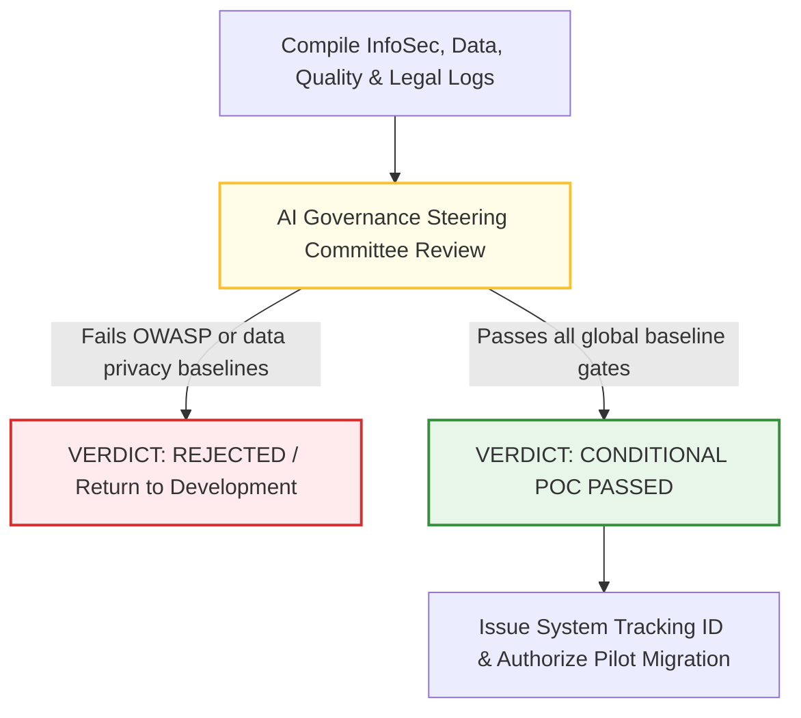

# 4.2 - Phase 1: Proof of Concept (POC) Compliance Manual

> **🗂️ Document Control Reference**
> * **Framework Index:** TK-SEC-4.2
> * **Current Version:** v2.0 (Subdirectory Reference Sync)
> * **Last Operational Review:** October 2026
> * *⚙️ Operational Customization Note: This manual serves as an adaptive baseline overlay and can be fully customized or expanded to align with your organization's specific technical, legal, and operational risk appetites.*
> * *Note: Subject to the master legal disclaimer located in the repository root [README.md](../../README.md).*

---

## 🏛️ Module 1: Phase Objective & Scope (ISO/IEC 42001 Alignment)
Once an AI use case clears sandbox testing and moves toward prototype construction with actual corporate infrastructure, it triggers **Phase 1 (POC)** [2.1]. The core objective of this gate is to conduct technical code audits and data-lineage safety reviews within a secure, non-production staging environment [2.1]. This stage directly operationalizes **[Document 1.1.1 - ISO 42001 Translation Manual](../../1-global-foundations/1.1-iso-standards/1.1.1-iso-42001-translation-manual.md) Clause 6.1.2 (AI Risk Assessment Process)** [2.1]. Because this occurs inside an isolated prototype environment using lenient data controls (Track A), zero live users or production assets are exposed to risk.

---

## 👥 Module 2: AI-Specific Review Overlay (Cross-Functional Focus)
Traditional IT risks (service accounts, firewall rules, general server hardening) are handled independently by standard corporate security desks. This module serves strictly as an **AI-Specific Governance Overlay**, tracking mandatory compliance checkpoints mapped directly to global standards:
* **Cybersecurity Review:** InfoSec architects audit prototype code and API integrations against **[Document 1.2.1 - OWASP LLM Security Manual](../../1-global-foundations/1.2-owasp-frameworks/1.2.1-owasp-LLM-security-manual.md)** and **[Document 1.2.4 - OWASP API Security Manual](../../1-global-foundations/1.2-owasp-frameworks/1.2.4-owasp-api-security-manual.md)** [2.1]. They verify system prompt architecture isolates system rules from test inputs to mitigate prompt injection vulnerabilities (`LLM01`).
* **Data Governance Review:** The Privacy Office audits the prototype ingestion layers to enforce compliance with **[Document 1.1.1 - ISO 42001 Translation Manual](../../1-global-foundations/1.1-iso-standards/1.1.1-iso-42001-translation-manual.md) Annex A.8 (Data for AI Systems)** and regional laws [2.1, 2.4]. They execute a *Synthetic Data Attestation* ensuring that 100% of data used during this phase is mock or randomized text, strictly blocking raw consumer records [2.4].
* **Model Quality Review:** The Model Validation Unit benchmarks baseline output reliability against **[Document 1.3.1 - NIST AI RMF Manual](../../1-global-foundations/1.3-nist-guidelines/1.3.1-nist-rmf-translation-manual.md)** parameters, executing one-time static accuracy and fluency checks.
* **Legal & Procurement Review:** Risk Counsel reviews supplier licensing against **[Document 1.1.1 - ISO 42001 Translation Manual](../../1-global-foundations/1.1-iso-standards/1.1.1-iso-42001-translation-manual.md) Annex A.10 (Relationships with Interested Parties)** [2.1]. They run a preliminary contract audit using our *Third-Party Vendor Vetting Questionnaire* to ensure the supplier provides secure single-tenant options [2.3].

---

## ⚙️ Module 3: Phase Exit Criteria & Committee Approval Flow
To clear Phase 1 and authorize code migration into the Pilot (UAT) cluster, the project must clear the centralized **AI Governance Steering Committee** review:

If any baseline OWASP security configurations or contract guidelines fail to clear, the committee issues a **Critical Block** and halts development. If passed, the committee issues a unique **System Tracking ID**, unlocking Phase 2 access [2.1, 2.3].

---

## 📋 Module 4: Mandatory Supporting Documents & Active Toolkit Assets
* 📋 **[4.7 - AI Steering Committee Approval Form](../Supporting-Utilities/4.7-ai-steering-committee-approval-form.md)**: The official corporate sign-off form and verdict sheet used by the AI Governance Board to authorize phase migrations.

---

## 📊 Module 5: Post-Phase Verification & Metrics Mapping
Upon committee sign-off, the lead assessor seals the prototype's compliance file. The project's status is updated to "POC Cleared" inside the company's registry. This prepares the code repository for the activation of **strict, continuous telemetry tracking** as it migrates to the live user environments of Phase 2 (Pilot) [2.1].
