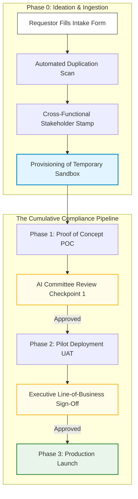

# 4.0 - Enterprise AI Delivery & Lifecycle Governance Process

> **🗂️ Document Control Reference**
> * **Framework Index:** REG-SEC-4.0
> * **Current Version:** v1.2
> * **Last Operational Review:** October 2026
> * *⚙️ Operational Customization Note: All processes, checklists, workflows, and templates provided within this directory are designed as modular baselines and can be fully customized, expanded, or modified to align with your specific organizational needs.*
> * *Note: Subject to the master legal disclaimer located in the repository root [README.md](../README.md).*

---

## 🏛️ Module 1: Framework Overview & Architecture

Implementing an effective Artificial Intelligence Management System (AIMS) under **ISO/IEC 42001** requires moving past static compliance checklists into a dynamic, end-to-end stage-gate delivery lifecycle. This manual establishes the organization's formal operating model, governing an AI use case from early business ideation to live continuous production tracking.

By separating the **Initiation & Discovery Phase** from the **Multi-Gate Compliance Pipeline**, this lifecycle minimizes administrative ticketing overhead, prevents duplicate software builds, and ensures data sovereignty and cyber risk mitigation loops are executed before infrastructure deployment.

---

## 📋 Module 2: Directory Taxonomy & Table of Contents

Navigate the lifecycle process stages and access active, downloadable template assets using the structured directory index below:

### 🗺️ The Lifecycle Phase Directories
* 📂 **[Phase 0 — Ideation](./Phase-0-Ideation/README.md)**: Manages use-case ingestion, portfolio alignment scans, business case financing validation, and temporary sandbox environment setups.
* 📂 **[Phase 1 — POC](./Phase-1-POC/README.md)**: Manages isolated prototype code-level audits, data lineage tracking, and baseline model quality benchmarking.
* 📂 **[Phase 2 — Pilot](./Phase-2-Pilot/README.md)**: Manages pre-production User Acceptance Testing (UAT) telemetry, live data logging setups, and quantitative fairness audits.
* 📂 **[Phase 3 — Production](./Phase-3-Production/README.md)**: Manages live production software launch parameters, automated shield filters, and threshold kill-switch configurations.

### 🛠️ The Shared Supporting Utilities
* 📂 **[Supporting Utilities](./Supporting-Utilities/README.md)**: Centralized repository housing cross-phase corporate policies, third-party vendor questionnaires, log tagging schemas, and smart monitoring matrices.
