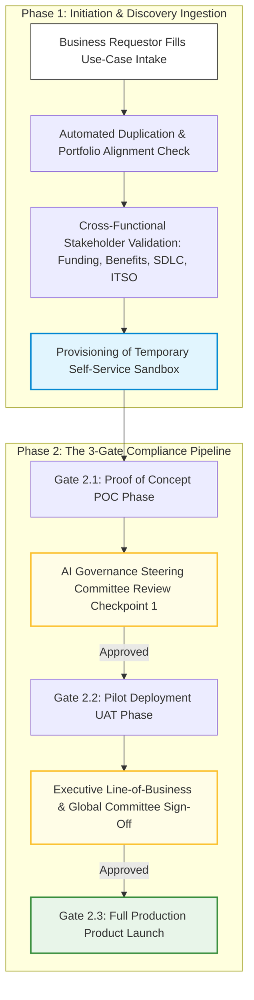

# 4.0 - Enterprise AI Delivery & Lifecycle Governance Process

> **🗂️ Document Control Reference**
> * **Framework Index:** REG-SEC-4.0
> * **Current Version:** v1.2
> * **Last Operational Review:** October 2026
> * *Note: This operational lifecycle process and all accompanying toolkit assets are strictly subject to the master legal disclaimer located in the repository root [README.md](../README.md).*

---

## 🏛️ Module 1: Framework Overview & Architecture

Implementing an effective Artificial Intelligence Management System (AIMS) under **ISO/IEC 42001** requires moving past static compliance checklists into a dynamic, end-to-end stage-gate delivery lifecycle. This manual establishes the organization's formal operating model, governing an AI use case from early business ideation to live continuous production tracking [2.1].

By separating the **Initiation & Discovery Phase** from the **Multi-Gate Compliance Pipeline**, this lifecycle minimizes administrative ticketing overhead, prevents duplicate software builds, and ensures data sovereignty and cyber risk mitigation loops are executed before infrastructure deployment [2.1].

---

## 🚦 Module 2: Phase 1 — Initiation, Discovery & Sandbox Ingestion

Before an AI initiative can enter the formal, resource-heavy compliance cycle, it must pass through the Ingestion Desk to validate business intent, budget availability, and engineering feasibility.

### Checkpoint 1.1: Use-Case Submission & Registry Mapping
* **The Operation:** The business requestor logs the project's parameters using **[Template 4.1](./4.1-ai-system-intake-template.md)**. The intake desk maps the proposal against the global *Enterprise AI Use-Case Inventory* to ensure a similar tool or fine-tuned model hasn't already been deployed or licensed by an alternate business unit. This eliminates duplicate expenditures and coordinates internal software portfolios.

### Checkpoint 1.2: The Temporary Testing Sandbox
* **The Operation:** Upon initial intent approval, the project is granted access to an isolated, automated **Temporary AI Testing Sandbox** utilizing anonymized or synthetic reference datasets.
* **The Strategic Value:** This platform allows engineering teams to freely test ideas, prove technical feasibility, and experiment before triggering formal risk tickets. By filtering out non-viable projects during early experimentation, it radically decreases the administrative load on compliance offices.

### Checkpoint 1.3: Cross-Functional Stakeholder Validation
Before clearing Phase 1, three mandatory enterprise owners must evaluate and stamp the use case:
* **The Business Owner:** Verifies that commercial funding is secured and explicitly documents the targeted cost-benefit ratio or revenue metrics.
* **The SDLC (Software Development Lifecycle) Owner:** Reviews the technology stack to ensure development steps align smoothly with corporate release pipelines.
* **The ITSO (Information Technology Security Officer):** Runs a boundary review to confirm the initial design does not breach core enterprise network security baselines.

---

## ⚙️ Module 3: Phase 2 — The 3-Gate Compliance Pipeline

Once a use case clears sandbox validation, it enters the formal, mandatory governance pipeline to clear code-level and risk-tier validation gates sequentially.

### Gate 2.1: Proof of Concept (POC)
* **Operational Scope:** The development team builds a localized prototype connecting to real systems but utilizing non-live, restricted internal data profiles.
* **Governance Checkpoints:** This is the first station where core risk reviews are initiated. Security teams execute static code analysis against **OWASP AI parameters**, data leads audit data lineage mappings, and compliance leads run preliminary evaluations against the **NIST AI RMF trustworthiness traits**.
* **The Sign-Off Bridge:** Because this occurs inside a sandboxed POC stage, zero live users are impacted. The completed logs are reviewed by the **Internal AI Governance Steering Committee** to pass the project forward or fail it if it breaches risk appetites.

### Gate 2.2: Pilot Deployment (UAT)
* **Operational Scope:** Code is migrated to pre-production testing environments, such as **User Acceptance Testing (UAT)** or localized pilot clusters, to face limited real-world user queries.
* **Governance Checkpoints:** Cybersecurity, data, and quality assessments are executed under load conditions. Compliance teams actively deploy telemetry trackers to monitor for early concept drift, user query shift anomalies, and output text generations.
* **The Sign-Off Bridge:** The performance ledger is submitted back to the AI Committee. Depending on the **Criticality and Risk Tier** of the application (e.g., a high-risk banking credit engine), the sign-off threshold is escalated to require formal approval from **Global Executive Committees** and senior **Line-of-Business Heads**.

### Gate 2.3: Full Production Product Launch
* **Operational Scope:** The application is deployed to live production environments, opening up access to the entire targeted consumer or corporate user base.
* **Governance Checkpoints:** Prior to opening production connectivity, compliance teams run an exhaustive validation review to guarantee that every system control engineered during the POC and Pilot stages is fully operational. Real-time input/output guardrail shields must be active, continuous model monitoring frameworks must be streaming telemetry, and technical **kill-switch protocols** must be tested and ready to execute if the system hits any operational threshold ceilings.

---

## 📋 Module 4: Downstream Operational Toolkit Directory
*To execute the specific lifecycle gates defined across this process, utilize the standardized, downloadable enterprise template files listed below:*

* 📋 **[4.1 - AI System Intake Template](./4.1-ai-system-intake-template.md)**: Standardized questionnaire used to classify model use cases and log metadata during **Phase 1 Ingestion**.
* 🛡️ **[4.2 - Generative AI Acceptable Use Policy](./4.2-generative-ai-acceptable-use-policy.md)**: Workforce behavioral guardrails and data handling matrices governing employee interactions with LLMs.
* 🔍 **[4.3 - Third-Party Vendor Vetting Questionnaire](./4.3-third-party-vendor-vetting-questionnaire.md)**: Technical due-diligence vetting form used to audit external AI suppliers during **Gate 2.1 (POC) procurement reviews**.
* ⚖️ **[4.4 - Algorithmic Impact Assessment (AIA) Template](./4.4-algorithmic-impact-assessment-template.md)**: Deep-dive risk evaluation framework used during **Gate 2.2 (Pilot) validations** to test for demographic parity and bias.
* 📝 **[4.5 - Enterprise AI Production Monitoring & Log-Tagging Schema](./4.5-enterprise-ai-monitoring-log-schema.md)**: Codified alphanumeric logging tags and structured text string templates used to engineer traceability into production codes.
* 📊 **[4.6 - AI Production Monitoring Assessment Template](./4.6-ai-production-monitoring-assessment.md)**: Continuous performance assessment matrix mapping calculation methodologies, testing frequencies, and threshold ceilings required for **Gate 2.3 Product Launch sign-offs**.
