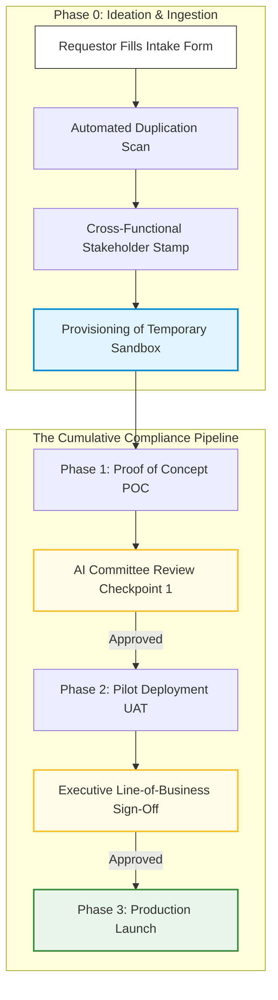

# 4.0 - Enterprise AI Delivery & Lifecycle Governance Process

> **🗂️ Document Control Reference**
> * **Framework Index:** REG-SEC-4.0
> * **Current Version:** v1.2
> * **Last Operational Review:** October 2026
> * *⚙️ Operational Customization Note: All processes, checklists, workflows, and templates provided within this directory are designed as modular baselines and can be fully customized, expanded, or modified to align with your specific organizational needs.*
> * *Note: Subject to the master legal disclaimer located in the repository root [README.md](../README.md).*

---

## 🏛️ Module 1: Framework Overview & Architecture

Implementing an effective Artificial Intelligence Management System (AIMS) under **ISO/IEC 42001** requires moving past static compliance checklists into a dynamic, end-to-end stage-gate delivery lifecycle [2.1]. This manual establishes the organization's formal operating model, governing an AI use case from early business ideation to live continuous production tracking [2.1].

By separating the **Initiation & Discovery Phase** from the **Multi-Gate Compliance Pipeline**, this lifecycle minimizes administrative ticketing overhead, prevents duplicate software builds, and ensures data sovereignty and cyber risk mitigation loops are executed before infrastructure deployment [2.1].

---

## 📋 Module 2: Directory Taxonomy & Table of Contents

Navigate the lifecycle process stages and access active, downloadable template assets using the structured directory index below:

### 🗺️ The Lifecycle Phase Directories
* 📂 **[Phase-0-ideation](./Phase-0-ideation/README.md)**: Manages use-case ingestion, portfolio alignment scans, business case financing validation, and temporary sandbox environment setups.
  * *Active Assets:* `4.0.1-ai-system-intake-template.md` [2.1]
* 📂 **[Phase-1-POC](./Phase-1-POC/README.md)**: Manages isolated prototype code-level audits, data lineage tracking, and baseline model quality benchmarking [2.1].
  * *Active Assets:* `4.2.1-cross-functional-poc-review-checklist.md` | `4.2.2-ai-steering-committee-approval-form.md` [2.1]
* 📂 **[Phase-2-Pilot](./Phase-2-Pilot/README.md)**: Manages pre-production User Acceptance Testing (UAT) telemetry, live data logging setups, and quantitative fairness audits [2.1].
  * *Active Assets:* `4.3.2-cross-functional-pilot-review-checklist.md` [2.1]
* 📂 **[Phase-3-Production](./Phase-3-Production/README.md)**: Manages live production software launch parameters, automated shield filters, and threshold kill-switch configurations [2.1].
  * *Active Assets:* `4.4.1-cross-functional-production-review-checklist.md` [2.1]

### 🛠️ The Shared Supporting Utilities
* 📂 **[Supporting-Utilities](./Supporting-Utilities/README.md)**: Centralized repository housing cross-phase corporate policies, third-party vendor questionnaires, log tagging schemas, and smart monitoring matrices [2.1].
  * *Active Asset Forms:* `4.1` (Intake), `4.2` (Policy), `4.3` (Vendor Vetting), `4.4` (AIA), `4.5` (Log Schema), `4.6` (Metrics Assessment), `4.7` (Committee Approval Form) [2.1].

---

## 👥 Module 3: Cross-Functional Review Ownership

To maintain operational integrity without duplicating baseline work, our framework enforces the **AI-Specific Governance Overlay**. Standard enterprise checks (general threat-modeling, standard service accounts validation, base network firewalling) are executed independently by traditional desks. 

The AI Governance lifecycle focuses strictly on specialized risk layers executed across the phase progression:

### 1. Cybersecurity Review (InfoSec Overlay)
* **Phase 1 (POC):** Lenient vs. Strict check. Evaluates prototype input architecture against prompt injections (`LLM01`) and output structures against insecure response rendering (`LLM02`) using the **OWASP GenAI Top 10** [2.1].
* **Phase 2 (Pilot):** Strict tracking. Mandates the execution of alphanumeric infrastructure logging codes (`[AI-SEC-INJ]`) to trace active jailbreak strings under pre-production user traffic loads [2.1].
* **Phase 3 (Production):** Zero-tolerance gate. Verifies that live, inline semantic shield models (e.g., LlamaGuard) are actively running to intercept and block exploits in real-time [2.1].

### 2. Data Governance Review (Privacy Overlay)
* **Phase 1 (POC):** Audits prototype ingestion streams to enforce data provenance under **ISO 42001 Annex A.8** [2.1]. Requires synthetic data attestation for non-live configurations [2.1].
* **Phase 2 (Pilot):** Continuous auditing. Extracts log telemetry (`[AI-PRIV-PII]`) to mathematically verify that the **PII Scrubbing** engine strips and hashes customer markers before they hit vector memories [2.1, 2.4].
* **Phase 3 (Production):** Complete cryptographic masking verification and localization verification, locking data hosting to approved geographic regions [2.5].

### 3. Model Quality Review (Validation Overlay)
* **Phase 1 (POC):** Executes static, one-time baseline accuracy checks against frozen validation datasets using **NIST AI RMF 1.0** parameters.
* **Phase 2 (Pilot):** Continuous verification. Deploys real-time evaluation frameworks to calculate and log scores for **Groundedness, Answer Relevance, and Context Precision** to block hallucinations dynamically.
* **Phase 3 (Production):** Live production dashboard tracking checking for concept drift and alerting engineers if model weights shift.

### 4. Legal & Procurement Review (Risk Counsel Overlay)
* **Phase 1 (POC):** Verifies third-party licenses and ensures supplier contracts carry explicit **Zero Data Retention (ZDR)** parameters under **ISO 42001 Annex A.10** [2.1, 2.3].
* **Phase 2 (Pilot):** Generates the **Algorithmic Impact Assessment (AIA)** [2.1]. Applies the statistical **Four-Fifths Rule** over the UAT ledger; a disparate impact ratio below **80% (0.80 threshold)** triggers an immediate compliance freeze.
* **Phase 3 (Production):** Establishes binding contractual SLA metrics and logs final metadata into the central registry for quarterly audit scheduling.

---

## ⚙️ Module 4: The Operating Lifecycle Execution Plan

When an application is moving through the pipeline, delivery leads must execute this standardized sign-off roadmap to clear checkpoints legally:

### 1. Ingestion and Sandbox Execution
* **Action:** Requestors log parameters via the intake questionnaire. If approved by the AI Portfolio Lead, the system is provisioned a temporary test cluster that automatically self-terminates after **30 days** to eliminate cloud resource leaks and environment sprawl.

### 2. Steering Committee Gate Sign-offs
* **Action:** At the conclusion of Phase 1 (POC) and Phase 2 (Pilot), all compiled cross-functional logs and questionnaires are structured inside the **AI Steering Committee Approval Form (`4.7`)** [2.1]. The board evaluates the residual risk, assigns a unique tracking number, or executes a critical block if risk thresholds are exceeded [2.1].

### 3. Activating Production Fallback Kill-Switches
* **Action:** If a live system in Phase 3 hits an operational threshold ceiling (e.g., Groundedness drops below 0.85 or toxicity flags trigger), the logging architecture must execute automated remediation steps:
  * *For Security/Fairness drops:* Force an immediate session termination, route the session to a safe static screen, and alert the Security Operations Center (SOC).
  * *For Quality/Accuracy drops:* Suppress the generative output entirely and render a pre-approved, static human-written text snippet to safeguard institutional equity.
