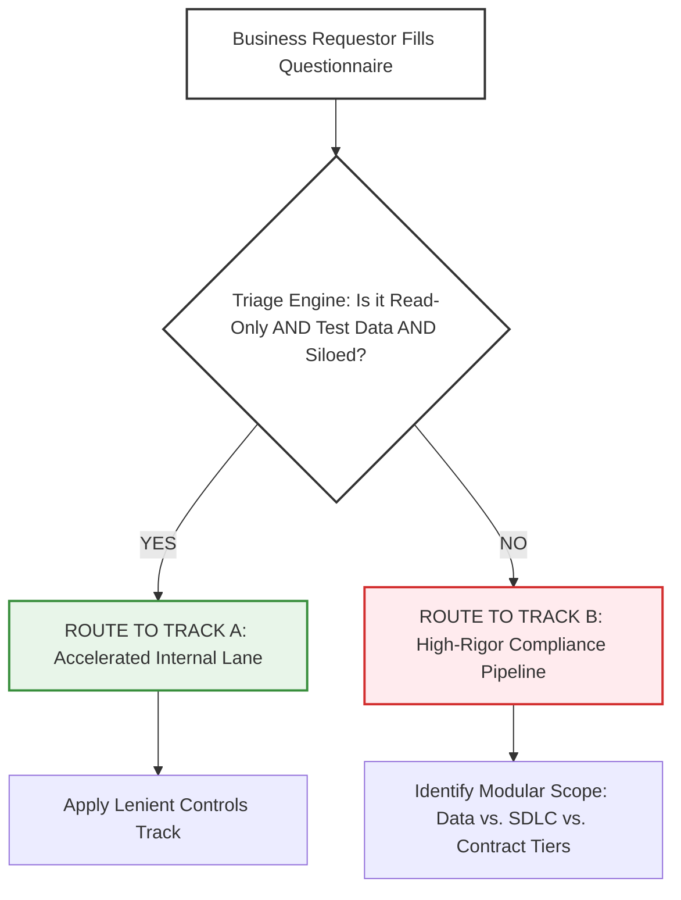

# 4.1 - Enterprise AI System Intake & Use-Case Inventory Template

> **🗂️ Document Control Reference**
> * **Framework Index:** TK-SEC-4.1
> * **Current Version:** v1.5
> * **Last Operational Review:** October 2026
> * *Note: Subject to the master legal disclaimer located in the repository root [README.md](../README.md).*

---

## 🏛️ Module 1: Executive Summary & Objective

Organizations frequently suffer from **"Shadow AI"**—where internal business groups or third-party engineering contractors connect corporate infrastructure to unvetted external AI applications without Information Security, Privacy, or Legal oversight. 

This toolkit establishes a binding, formalized entry gate. It forces business requestors and application architects to comprehensively document the *business intent, data footprint, cloud architecture,* and *operational constraints* of any proposed AI system before line-of-business capital allocation or system profiling approval [2.1].

---

## 📅 Module 2: The Step-by-Step Operational Intake Lifecycle

1. **Identification:** The internal business unit or delivery lead completes and submits the *AI System Procurement & Intake Form* (Module 3).
2. **Deterministic Triage Gate:** The system evaluates the choices against the corporate governance baseline rule:
   * **🟢 TRACK A (Accelerated Internal Lane):** Triggered *only* if the application is strictly **Read-Only**, utilizes **100% Test/Synthetic Data**, and operates within a **Secure/Siloed Cloud Tenant**. All real-time inline semantic shields, demographic fairness parity math, and heavy regional statutory liabilities are deactivated.
   * **🔴 TRACK B (Strict Compliance Lane):** Triggered automatically if the system writes/merges to code branches, alters deployment environments, logs data to unvetted public networks, or reads live production customer records.
3. **Modular Governance Assessment Scope:** For Track B projects, the triage ledger maps which modular components apply (e.g., if a project uses synthetic data but alters the CI/CD pipeline, the *Data Governance Review* blocks are marked **Not Applicable**, while the *Cybersecurity SDLC Shield* blocks are marked **Mandatory**).
4. **Action Registry:** The final metadata profiling vectors are logged into the centralized *Enterprise AI System Inventory Log* (Module 4) for ongoing continuous validation.

---

## 🛡️ Module 3: Enterprise AI System Procurement & Intake Form

### 📋 Section A: Business Unit & Project Context
* **Project Name:** __________________________________________________
* **Business Requestor Name & Title:** __________________________________________________
* **Department / Line of Business:** __________________________________________________
* **Primary Business Objective:** *Provide a clear summary detailing exactly what operational problem this AI system solves.*
  __________________________________________________________________________________________________

### 💻 Section B: Model Architecture & Deployment Topology

#### B.1 Deployment Tenant Security
* [ ] **🟢 Secure/Siloed Architecture:** Fine-tuning, hosting, or orchestrating models within a dedicated private enterprise cloud tenant (e.g., corporate Azure OpenAI instance) or internal secure local data centers. Data inputs cannot be viewed or logged by external providers.
* [ ] **🔴 Public Multi-Tenant / Open Horizon:** Utilizing public unvetted SaaS applications or multi-tenant APIs where model prompts are logged, cached, or used by third parties for base engine optimizations. *(Triggers Track B: Mandatory Contractual/ZDR Audit)*

#### B.2 Model Vendor Specifics
* **Foundation Engine Details:** *State the foundation engine name, version, and the supplier organization (e.g., Anthropic Claude 3.5 Sonnet v2 via AWS Bedrock).*
  __________________________________________________________________________________________________

### 🔒 Section C: Data Governance & Geometry Footprint

#### C.1 Inherent Data State
* [ ] **🟢 100% Test / Dummy / Synthetic Data:** System processes randomized text mocks, public documentation libraries, or synthetic reference datasets only. Real-world consumer markers or unmasked corporate records are structurally barred.
* [ ] **🔴 Live Production Data Active:** Infrastructure connects to live transaction ledgers, authenticated employee records, or active customer asset arrays. *(Triggers Track B: Mandatory Privacy and Data Sovereignty Guards)*

#### C.2 Data Classification & Jurisdictional Footprint
*Complete ONLY if Section C.1 is marked as "Live Production Data". If C.1 is Synthetic, skip directly to Section D.*
* **Data Fields Ingested (Select all that apply):**
  * [ ] Customer **Personally Identifiable Information (PII)** or financial account numbers [2.4].
  * [ ] Corporate **Protected Intellectual Property (IP)** or private software code repositories.
  * [ ] **Biometric Data**, facial recognition arrays, or voice print metrics.
* **Jurisdictional Reach (Select all that apply):**
  * [ ] European Union (EU AI Act Scope) [2.1]
  * [ ] Singapore (MAS Guidelines Scope) [2.3]
  * [ ] India (DPDP Act 2023 Scope) [2.4]
  * [ ] Dubai International Financial Centre (DIFC Law No. 5 Scope) [2.5]

---

### 🤖 Section D: System Autonomy & Operational Impact (The Agency Vector)

#### D.1 Interface Authority & Capability Loop
* [ ] **🟢 Pure Read-Only / Information Retrieval:** System serves as an advisory chatbot or search reference utility. It cannot write code, call execution APIs, edit text repositories, or execute system state adjustments.
* [ ] **🔴 Operational Action / SDLC Write Capability:** The system holds write, commit, or execute permissions. It can modify application parameters, automate pull request merges, alter CI/CD staging pipelines, or trigger external API payloads. *(Triggers Track B: Mandatory Infrastructure and Supply Chain Shields)*

#### D.2 Operational Protection Controls
* **Is there a technical "Kill-Switch" protocol configured to instantly suspend the system in production if anomalies are detected?**
  * [ ] Yes (Attach the automated rollback script blueprint)
  * [ ] No (Intake will be paused until architectural rollback controls are designed)

---

## 📊 Module 4: Centralized Enterprise AI System Inventory Log

### Triage Decision & Scope Mapping Table
*The AI Governance Lead records the final deterministic route and maps the modular governance components below based on the Module 3 selections to reflect the comprehensive operational intersect matrix.*

| System Tracking ID | Project Operational Profile / Intent | Baseline Verdict | Cybersecurity Block (SDLC / Shields) | Data Governance Block (Privacy / Sovereignty) | Legal / Procurement (ZDR Contracts / SLA) |
| :--- | :--- | :--- | :--- | :--- | :--- |
| **AI-2026-REG-001** | **Isolated Test Document Search:** Isolated workspace, synthetic data, read-only, private cloud. | 🟢 **Track A** | Baseline Code QA | Not Applicable | Standard License Check |
| **AI-2026-REG-002** | **IP Refactor Assistant:** Synthetic data, read-only, public unvetted SaaS API platform. | 🔴 **Track B** | Baseline Code QA | Not Applicable | **MANDATORY** (Strict Contractual / ZDR Audit) |
| **AI-2026-REG-003** | **Synthetic Dev Agent:** Secure cloud tenant, synthetic records, autonomous tool execution. | 🔴 **Track B** | **MANDATORY** (Financial & Loop Controls) | Not Applicable | Standard License Check |
| **AI-2026-REG-004** | **CI/CD Pipeline Optimizer:** Technical code assets, alters SDLC pipelines, autonomous write hooks. | 🔴 **Track B** | **MANDATORY** (Strict Infrastructure Shields) | Not Applicable | **MANDATORY** (AI-SBOM Supply Chain Audit) |
| **AI-2026-REG-005** | **Production Client Analytics:** Production customer records, isolated read-only interface. | 🔴 **Track B** | **MANDATORY** (Inline Shields Active) | **MANDATORY** (Strict Privacy Guards) | **MANDATORY** (Binding ZDR / Liability Limits) |
