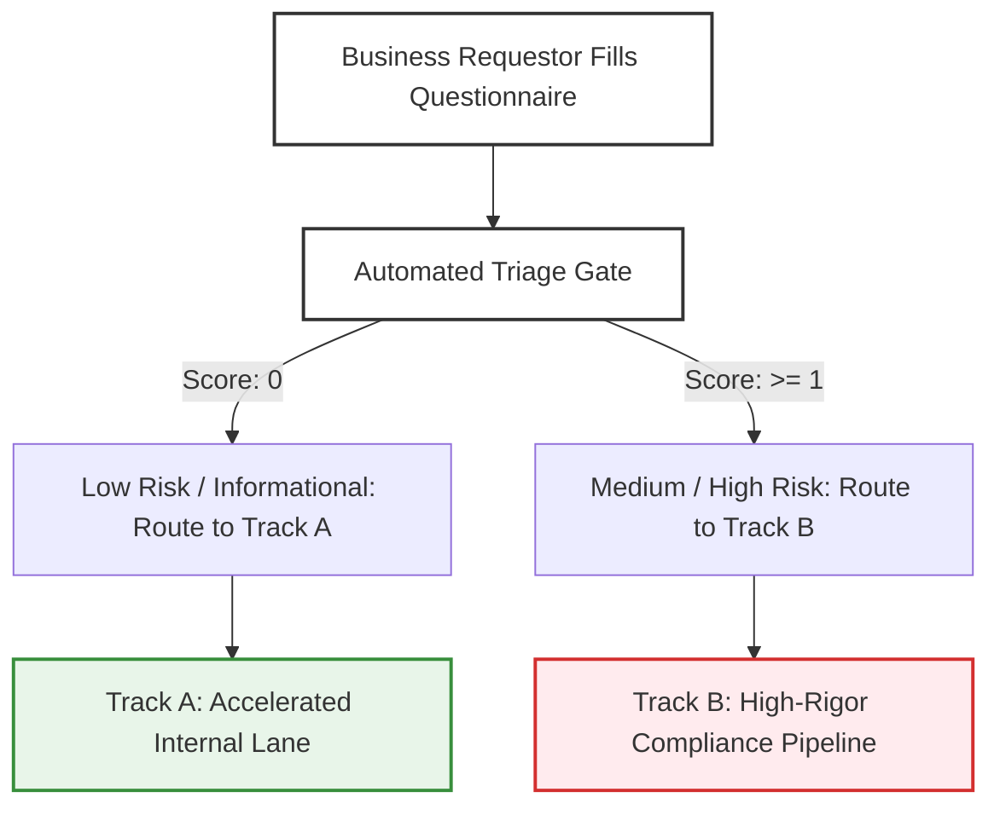

# 4.1 - Enterprise AI System Intake & Use-Case Inventory Template

> **🗂️ Document Control Reference**
> * **Framework Index:** TK-SEC-4.1
> * **Current Version:** v1.3
> * **Last Operational Review:** October 2026
> * *Note: Subject to the master legal disclaimer located in the repository root [README.md](../README.md).*

---

## 🏛️ Module 1: Executive Summary & Objective

Organizations frequently suffer from **"Shadow AI"**—where internal business groups or third-party engineering contractors connect corporate infrastructure to unvetted external AI applications without Information Security, Privacy, or Legal oversight. 

This toolkit establishes a binding, formalized entry gate. It forces business requestors and application architects to comprehensively document the *business intent, data footprint, cloud architecture,* and *operational constraints* of any proposed AI system before line-of-business capital allocation or system profiling approval [2.1].

---

## 📅 Module 2: The Step-by-Step Operational Intake Lifecycle

1. **Identification:** The internal business unit or delivery lead completes and submits the *AI System Procurement & Intake Form* (Module 3).
2. **Automated Triage:** The AI Governance Officer evaluates the submitted data classifications, interface parameters, and autonomy configurations.
3. **Operational Track Assignment:** 
   * **🟢 TRACK A (Accelerated Internal Lane):** Triggered if the use case scores **0** on high-rigor parameters. App-development bypasses real-time inline semantic shields and demographic parity audits, focusing entirely on baseline cost and code QA.
   * **🔴 TRACK B (Strict Compliance Lane):** Triggered automatically if **ANY SINGLE** high-rigor parameter block is checked. The application is flagged as a high-risk enterprise asset and must clear all strict checkpoints across Phases 1, 2, and 3.
4. **Action Registry:** Upon classification, the application metadata is securely logged into the centralized *Enterprise AI System Inventory Log* (Module 4) for ongoing continuous validation.

---

## 🛡️ Module 3: Enterprise AI System Procurement & Intake Form
*Deploy this form internally via automated workflows such as Microsoft Forms, Jira Service Desk, or ServiceNow.*

### 📋 Section A: Business Unit & Project Context
* **Project Name:** __________________________________________________
* **Business Requestor Name & Title:** __________________________________________________
* **Department / Line of Business:** __________________________________________________
* **Primary Business Objective:** *Provide a clear, non-technical explanation detailing exactly what problem this AI system solves and what corporate goal it enables.*
  __________________________________________________________________________________________________

### 💻 Section B: Model Architecture & Deployment Topology
* **Model Deployment Type (Select One):**
  * [ ] **Third-Party SaaS:** Direct interaction with an external host platform (e.g., ChatGPT Enterprise, Claude Team, Microsoft 365 Copilot).
  * [ ] **API Integration / Orchestration:** Connecting internal corporate applications to external foundation model endpoints (e.g., OpenAI API hosted via corporate Azure tenant infrastructure).
  * [ ] **Proprietary / In-House Model:** Training, fine-tuning, or hosting an open-source model directly within local private data centers (e.g., Llama-3 hosted on internal enterprise server clusters).
* **Vendor Model Specifics:** *State the foundation engine name, version, and the supplier organization (e.g., Anthropic Claude 3.5 Sonnet v2 via AWS Bedrock).*
  __________________________________________________________________________________________________

### 🔒 Section C: Data Governance & Jurisdictional Footprint
*Any checkbox marked with a 🔴 represents an automatic High-Rigor Trigger that forces the project into Track B.*

* **Data Classification Checkpoints (Select all that apply):**
  * [ ] 🔴 Ingests or processes Customer **Personally Identifiable Information (PII)** or protected health identifiers [2.4].
  * [ ] 🔴 Accesses Corporate **Protected Intellectual Property (IP)**, private software code bases, or trade secrets.
  * [ ] 🔴 Utilizes **Biometric Data**, facial recognition arrays, or voice print metrics.
  * [ ] 🔴 Ingests **Financial Transactional Ledger Records** or credit history data.
  * [ ] Processes **Publicly Available Information** or static reference text blocks only. *(Track A Parameter)*
* **Jurisdictional Reach (Select all that apply):**
  * [ ] 🔴 The system will process data belonging to citizens within the **European Union (EU AI Act Scope)** [2.1].
  * [ ] 🔴 The system will operate within the financial sector of **Singapore (MAS Guidelines Scope)** [2.3].
  * [ ] 🔴 The system will ingest personal data from individuals within **India (DPDP Act 2023 Scope)** [2.4].
  * [ ] 🔴 The system will operate inside the economic free-zone of the **Dubai International Financial Centre (DIFC Law No. 5 Scope)**.

### 🤖 Section D: System Autonomy & Human Oversight Hooks
* **Autonomy Configuration Model (Select One):**
  * [ ] 🔴 **Fully Autonomous (Human-out-of-the-Loop):** The AI agent or model evaluates parameters, calls external API tools, and executes operational decisions or transactions completely on autopilot without human confirmation.
  * [ ] **Human-Assisted (Human-in-the-Loop):** The AI model serves as a recommendation engine. It prints potential insights to a frontend dashboard, but the action remains locked until a verified human employee clicks to approve or reject the final outcome. *(Track A Parameter)*
  * [ ] **Informational Only:** Used exclusively for internal brainstorming, content drafting, or static text formatting loops with zero operational code footprint. *(Track A Parameter)*
* **Is there a technical "Kill-Switch" protocol configured to instantly suspend the system in production if anomalies are detected?**
  * [ ] Yes (Attach the automated rollback script blueprint)
  * [ ] No (Intake will be paused until architectural rollback controls are designed)

---

## 📊 Module 4: Centralized Enterprise AI System Inventory Log
*Once an intake form clears all preliminary validation gates, the AI Governance Lead must log the application metadata into this standardized registry layout for continuous auditing.*

| System Tracking ID | Operating Department | Technical Model Source | Operational Compliance Track | Regulatory Classification Reference | Next Scheduled Validation Review |
| :--- | :--- | :--- | :--- | :--- | :--- |
| **AI-2026-REG-001** | Human Resources | Third-Party SaaS | 🔴 **Track B (Strict)** | **EU AI Act Tier 2** (Employment) [2.1] | October 2026 |
| **AI-2026-REG-002** | Technology Office | Cloud LLM API | 🟢 **Track A (Lenient)** | **IMDA Agentic AI Framework** v1.5 [2.3] | January 2027 |
| **AI-2026-REG-003** | Risk & Compliance | Local Open-Source Model | 🟢 **Track A (Lenient)** | **NIST AI RMF 1.0** (Govern) | July 2027 |
| **AI-2026-REG-004** | Consumer Banking | Enterprise Vendor API | 🔴 **Track B (Strict)** | **MAS Guidelines Circular** Sec 3 [2.3] | October 2027 |
