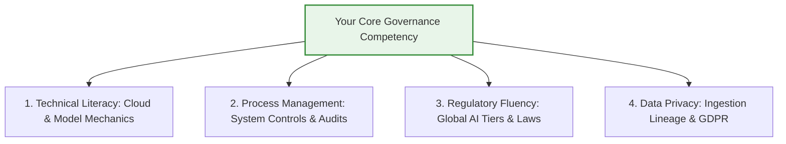
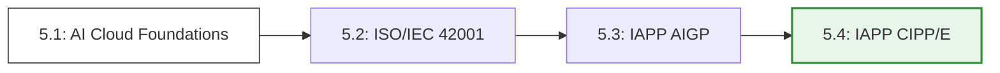

# Section 5 — The AI Governance Learning Guild Hub

## ⚖️ Legal Disclaimer & Terms of Use
*The content provided within this learning directory is intended solely for educational, academic, and professional training demonstration purposes. It does not constitute formal vocational accreditation, regulatory legal advice, or official certification preparation counseling. Users must consult accredited global authorities (such as the IAPP or ISO committees) before sitting for formal industry examinations.*

---

## 🌐 Directory Overview: How to Enter AI Governance
Artificial Intelligence risk management is a rapidly growing, cross-functional discipline. Entering this space **does not require writing complex software code**, training neural networks, or building machine learning models from scratch. 

Instead, it requires building execution competence across cloud technical literacy, process control mapping, and international regulatory law. The role of a governance professional is to act as the translator and the operational bridge between Information Security, Data Science, and the C-Suite.

---

## 🛡️ The 4-Stage AI Governance Certification Pathway

To formally prove these four competencies to corporate recruiters and global institutions, professionals should execute this targeted, AI-specific certification pathway sequentially. 

Click on any specific credential below to access my specialized, deep-dive study blueprints, resource indexes, and exam-clearing strategies:

### 📋 Core Curriculum Directory
* ☁️ **[5.1 - AI Cloud Foundations Certification Guide](./5.1-ai-cloud-foundations-guide.md)**
  * *Focus:* Deep-dive exam preparation for the **AWS Certified AI Practitioner**, **Azure AI Fundamentals (AI-900)**, or **Google Cloud GenAI** baselines to master API hooks and RAG data pipelines.
* ⚙️ **[5.2 - ISO/IEC 42001 Systems Implementer Guide](./5.2-iso-42001-implementer-guide.md)**
  * *Focus:* Actionable blueprints for mastering the official standard text, building an internal AIMS skeleton, and mapping Clause 6 risk requirements.
* ⚖️ **[5.3 - IAPP Certified AI Governance Professional (AIGP) Study Guide](./5.3-iapp-aigp-study-guide.md)**
  * *Focus:* Strategic roadmap for clearing the global benchmark exam, mapping the EU AI Act risk gates, and navigating MAS Singapore guidelines.
* 🔒 **[5.4 - IAPP Certified Information Privacy Professional/Europe (CIPP/E) Guide](./5.4-iapp-cippe-privacy-guide.md)**
  * *Focus:* Advanced mapping of data privacy boundaries, GDPR compliance frameworks, automated profiling limits (Article 22), and PII scrubbing loops.
* 🏫 **[5.5 - Train-the-Trainer Workshop Kit](./5.5-train-the-trainer-kit.md)**
  * *Focus:* A plug-and-play academic resource featuring free 3-day corporate course slide outlines, interactive classroom activities, and mock audit examination grading modules.

---

## 🔗 Repository Navigation Reference
👉 **[Return to Main Portfolio Landing Page](../README.md)**
