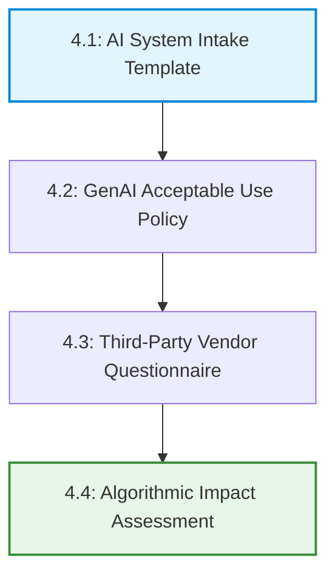

# AI Governance & Risk Management Portfolio

Welcome to my enterprise AI Governance portfolio. This repository serves as an active, production-grade reference framework designed to help organizations build robust, audit-ready **AI Management Systems (AIMS)**. 

My work bridges corporate strategy, data ethics, and technical risk control, drawing from my training in **ISO/IEC 42001 (Lead Implementer)** and the **IAPP AIGP** framework ecosystems.

---

## 📁 Repository Index & Taxonomy

* 🌐 **[1-global-foundations](./1-global-foundations/)**: Cross-framework mapping matrices and technical security standards for Large Language Models, RAG pipelines, and infrastructure layers.
* 🌍 **[2-regional-regulations](./2-regional-regulations/)**: Localized compliance playbooks and statutory implementation guides for major international markets (EU, Singapore, Hong Kong, India, UAE, US, Australia).
* 📝 **[3-ai-governance-annual-paper](./3-ai-governance-annual-paper/)**: Flagship industry trend research tracking shifting international regulatory balances and technical exploits.
* 🛠️ **[4-operational-toolkits](./4-operational-toolkits/)**: Downloadable, ready-to-implement enterprise assessment templates and corporate policies to execute lifecycle compliance.
* 🎓 **[5-learning-guild-hub](./5-learning-guild-hub/)**: Open-source vocational roadmaps, curricula, and training kits built for upcoming professionals and educators.

---

## ⚙️ The Phase-Based Operational Toolkit Loop

This lifecycle demonstrates how downloadable toolkit templates in Section 4 integrate to push corporate AI initiatives through enterprise deployment gates safely:

---

## 🎯 Professional Core Competencies
* **AI Management System (AIMS) Design:** Implementing organizational controls aligned with ISO/IEC 42001 rules.
* **Algorithmic Bias Auditing:** Running pre-launch statistical fairness checks using demographic parity benchmarks.
* **Technical Security Vetting:** Auditing applications using the OWASP GenAI and Agentic Top 10 vulnerabilities.
* **Vendor Due Diligence:** Vetting external third-party models for Zero Data Retention (ZDR) and privacy compliance.
* **Cross-Functional Enablement:** Translating complex laws into step-by-step developer checklists and workflows.

---

## 👤 About Me
Hi, my name is Rajat Sharma and I am a dedicated AI Governance, Risk, and Compliance professional focused on helping organizations responsibly deploy machine learning technologies. By translating abstract ethical principles and complex cross-border regulations into clear, executable operating models, I ensure AI systems remain safe, transparent, and legally compliant without bottlenecking strategic innovation.

### 🤝 Let's Connect
* **LinkedIn:** [linkedin.com/in/rajat-sharma-pm/](https://www.linkedin.com/in/rajat-sharma-pm/)
* **Email:** sharma.rajat.work@gmail.com

---

## ⚖️ Legal Disclaimer & Terms of Use
*The content provided across this entire repository and its sub-directories is intended solely for educational, informational, and professional portfolio demonstration purposes. It does not constitute formal legal advice, regulatory counseling, or professional compliance auditing. While every effort is made to maintain factual accuracy relative to shifting global regulatory benchmarks, users must consult qualified legal counsel or certified data protection authorities before implementing these frameworks in a commercial production environment. The author accepts no liability for operational, financial, or legal actions resulting from the independent application of this material.*
